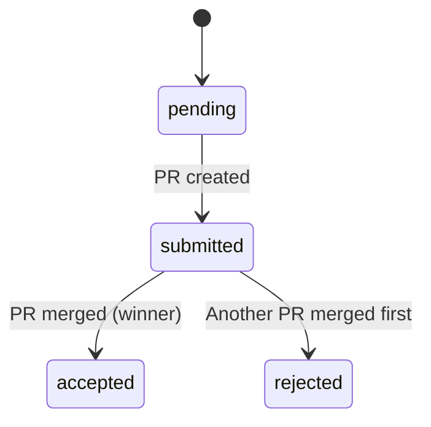

# Documentation Standards

**Status:** Active
**Last Updated:** 2025-11-16
**Enforcement:** ESLint + TypeDoc + Pre-commit hooks

---

## Overview

This document defines documentation standards for the coding-arena project. All code contributions must follow these standards, which are enforced through automated tooling.

---

## 1. JSDoc Requirements

### 1.1 What Must Be Documented

**Required Documentation (Enforced by ESLint):**
- All exported functions
- All exported classes and methods
- All TypeScript interfaces
- All TypeScript type aliases
- All TypeScript enums
- **All properties within types/interfaces** (Enforced by TypeDoc)

**Optional Documentation:**
- Arrow functions (not enforced, but encouraged for complex logic)
- Function expressions (not enforced)
- Internal/private functions (encouraged but not required)

### 1.2 JSDoc Format

#### Functions
```typescript
/**
 * Brief one-line description of what this function does.
 *
 * More detailed explanation if needed, including algorithm details,
 * performance considerations, or important behavior notes.
 *
 * @param paramName - Description of parameter
 * @param anotherParam - Description of another parameter
 * @returns Description of return value
 * @throws {ErrorType} When this error condition occurs
 * @example
 * ```typescript
 * const result = myFunction('input', 42)
 * console.log(result) // Expected output
 * ```
 */
export function myFunction(paramName: string, anotherParam: number): string {
  // Implementation
}
```

#### Types and Interfaces
```typescript
/**
 * Brief description of what this type represents.
 *
 * Additional context about when to use this type, its purpose,
 * or relationship to other types.
 */
export interface MyType {
  /** The unique identifier for this resource */
  id: string

  /**
   * The status of the resource
   * @example 'pending', 'active', 'completed'
   */
  status: string

  /** Optional metadata as JSON object */
  metadata?: Record<string, unknown>

  /**
   * ISO 8601 timestamp of when this was created
   * @example '2025-11-16T12:00:00Z'
   */
  createdAt: string
}
```

#### Enums
```typescript
/**
 * Valid status values for agent participation in an issue.
 */
export enum AgentStatus {
  /** Agent has been mentioned but not yet dispatched */
  PENDING = 'pending',

  /** Agent has submitted a PR */
  SUBMITTED = 'submitted',

  /** Agent's PR was merged (winner) */
  ACCEPTED = 'accepted',

  /** Agent's PR was not merged (loser) */
  REJECTED = 'rejected',

  /** Agent was assigned but never submitted */
  IGNORED = 'ignored'
}
```

### 1.3 Property Documentation Requirements

**Every property must have a JSDoc comment**, including:
- What the property represents
- Valid values or format (if not obvious from type)
- Examples for complex types
- References to external APIs (Linear, GitHub) if applicable

**Good Examples:**
```typescript
interface Issue {
  /** Linear issue unique identifier (e.g., '3f2a1c4b-5e6d-7890-abcd-ef1234567890') */
  linearId: string

  /** Linear issue key in format TEAM-123 (e.g., 'CA-42') */
  linearKey: string

  /**
   * Current status from Linear workspace
   * @example 'Done', 'In Progress', 'Backlog', 'Canceled'
   */
  status: string | null

  /** ISO 8601 timestamp of when the arena:ready label was added */
  arenaReadyLabeledAt: Date | null

  /**
   * Hex color code for label display
   * @example '#FF5733'
   */
  color?: string
}
```

**Bad Examples (Don't do this):**
```typescript
interface Issue {
  id: string // ❌ No JSDoc comment
  status: string // ❌ No JSDoc comment
  data: any // ❌ No JSDoc comment
}
```

---

## 2. TypeDoc Configuration

### 2.1 Current Configuration

**File:** `typedoc.json`

```json
{
  "entryPoints": ["./src"],
  "entryPointStrategy": "expand",
  "out": "./docs/api",
  "exclude": [
    "**/*.test.ts",
    "**/*.test.tsx",
    "**/*.spec.ts",
    "**/*.spec.tsx",
    "**/__tests__/**"
  ],
  "excludePrivate": true,
  "plugin": ["typedoc-plugin-mermaid"],
  "validation": {
    "notExported": true,
    "invalidLink": true,
    "notDocumented": true
  },
  "treatWarningsAsErrors": true
}
```

### 2.2 Enforcement

**TypeDoc warnings are treated as ERRORS** - builds will fail if documentation is missing.

**Pre-commit Hook:**
```bash
npm run validate && npm run docs || exit 1
```

This ensures documentation builds successfully before every commit.

---

## 3. Architectural Documentation

### 3.1 When to Write Architectural Docs

Create architectural documentation when:
- Implementing complex algorithms (e.g., two-phase comment sync)
- Addressing race conditions or concurrency concerns
- Designing state machines or workflows
- Making architectural decisions (database schema, API design)
- Implementing security measures (webhook verification, idempotency)

### 3.2 Architectural Doc Location

Place architectural docs in `/docs/` directory:
- `/docs/[FEATURE_NAME].md` - Feature-specific architecture
- `/docs/[SYSTEM_NAME]-state-machine.md` - State machine diagrams
- `/docs/plans/YYYY-MM-DD-[description].md` - Design documents and bug reports

### 3.3 Architectural Doc Template

```markdown
# [Feature Name]

**Status:** [Active/Deprecated/Proposed]
**Last Updated:** YYYY-MM-DD
**Related Files:**
- `/src/path/to/file.ts`
- `/src/another/file.ts`

---

## Overview

Brief summary of what this feature/system does and why it exists.

---

## Architecture

### High-Level Design
[Mermaid diagram or description]

### Key Components
- Component 1: Purpose and responsibility
- Component 2: Purpose and responsibility

### Data Flow
[Step-by-step explanation of how data flows through the system]

---

## Implementation Details

### Critical Logic
[Explain complex algorithms, race condition handling, etc.]

### Edge Cases
[Document known edge cases and how they're handled]

---

## Testing Strategy

[How this feature is tested, coverage requirements, etc.]

---

## Future Improvements

[Known limitations, planned enhancements]
```

---

## 4. Code Comments

### 4.1 When to Add Inline Comments

**Do Add Comments For:**
- Complex algorithms or non-obvious logic
- Race condition handling
- Security measures
- Performance optimizations
- Workarounds for external API limitations
- TODO items with context

**Don't Add Comments For:**
- Self-explanatory code
- Repeating what the code already says
- Outdated information

### 4.2 Comment Style

**Good Comments:**
```typescript
// Two-phase algorithm: First pass builds parent relationship map,
// second pass resolves agent ownership by walking parent chains.
// This handles nested comment threads where the @mention is in a parent comment.
const parentMap = buildCommentParentMap(comments)
```

**Bad Comments:**
```typescript
// Loop through comments
for (const comment of comments) {
  // Process comment
  processComment(comment)
}
```

---

## 5. API Documentation

### 5.1 API Route Documentation

All API routes must include:
- Route description
- Request/response types
- Error responses
- Security measures (signature verification, etc.)

**Example:**
```typescript
/**
 * PATCH /api/agents/[id]
 *
 * Updates an agent's enabled status.
 *
 * @param request - Next.js request with JSON body: { isEnabled: boolean }
 * @param context - Route context with params.id (agent UUID)
 * @returns Updated agent object or error response
 *
 * @example
 * PATCH /api/agents/123e4567-e89b-12d3-a456-426614174000
 * Body: { "isEnabled": true }
 *
 * Response: { "id": "...", "name": "cursor", "isEnabled": true, ... }
 */
export async function PATCH(
  request: NextRequest,
  context: { params: Promise<{ id: string }> }
): Promise<NextResponse> {
  // Implementation
}
```

---

## 6. Database Schema Documentation

### 6.1 Table Documentation

All database tables must include:
- Table purpose
- Key relationships
- Constraints and indexes
- Data lifecycle (when records are created/deleted)

**Example:**
```typescript
/**
 * Tracks individual PR submissions from agents for issues.
 *
 * Lifecycle:
 * - Created when PR is linked to Linear issue (via attachment webhook)
 * - Updated when PR receives new commits (GitHub webhook)
 * - Status updated on PR merge/close (GitHub webhook)
 * - Cascade deleted when parent issue is deleted
 *
 * Relationships:
 * - Many-to-one with issues (foreign key: issueId)
 * - One-to-many with ciMetrics (CI test data)
 *
 * Constraints:
 * - UNIQUE(issueId, agentName, prNumber) - prevents duplicate attempts
 */
export const attempts = pgTable('attempts', {
  /** Unique attempt identifier */
  id: uuid('id').primaryKey().defaultRandom(),

  /** Foreign key to parent issue (cascade delete) */
  issueId: uuid('issue_id')
    .notNull()
    .references(() => issues.id, { onDelete: 'cascade' }),

  // ... rest of schema
})
```

---

## 7. Test Documentation

### 7.1 Test File Organization

- Place test files alongside source files: `file.ts` → `file.test.ts`
- Group tests by feature using `describe()` blocks
- Use clear test names that explain what is being tested

### 7.2 Test Descriptions

**Good Test Names:**
```typescript
describe('updateWinner', () => {
  it('should select first merged attempt as winner', async () => { ... })
  it('should handle concurrent webhook calls with transaction locking', async () => { ... })
  it('should skip if winner already set (idempotent)', async () => { ... })
})
```

**Bad Test Names:**
```typescript
describe('updateWinner', () => {
  it('works', async () => { ... }) // ❌ Too vague
  it('test 1', async () => { ... }) // ❌ No description
  it('should work correctly', async () => { ... }) // ❌ Not specific
})
```

---

## 8. Mermaid Diagrams

### 8.1 When to Use Diagrams

Use Mermaid diagrams for:
- State machines
- Data flow
- Sequence diagrams for complex interactions
- Entity relationship diagrams

### 8.2 Diagram Placement

**In JSDoc:**
```typescript
/**
 * Handles PR status transitions.
 *
 * ```mermaid
 * stateDiagram-v2
 *   [*] --> open
 *   open --> merged
 *   open --> closed
 *   merged --> [*]
 *   closed --> [*]
 * ```
 */
```

**In Markdown Docs:**
```markdown
## State Machine


```

---

## 9. Enforcement

### 9.1 Automated Checks

**Pre-Commit Hook:**
- Type checking (99.9% coverage required)
- ESLint (includes JSDoc validation)
- Tests (90% coverage required)
- Prettier formatting
- **TypeDoc generation** (must succeed without errors)

**CI/CD:**
- All pre-commit checks run in GitHub Actions
- Test coverage must meet 90% threshold
- Zero ESLint warnings tolerated

### 9.2 Manual Review

Code reviews should verify:
- JSDoc accuracy (not just presence)
- Architectural doc updates for significant changes
- Test documentation matches behavior
- Comments explain "why" not "what"

---

## 10. Example: Complete Documentation

Here's a complete example showing all standards applied:

```typescript
/**
 * Updates the winner for an issue when a PR is merged.
 *
 * Uses PostgreSQL row-level locking (FOR UPDATE) to prevent race conditions
 * when multiple webhooks arrive concurrently. The first merged PR wins.
 *
 * Algorithm:
 * 1. Lock issue row (blocks concurrent transactions)
 * 2. Check if winner already set (idempotent)
 * 3. Find first merged attempt by mergedAt timestamp
 * 4. Set winner and update issue status to 'completed'
 * 5. Close losing open attempts
 * 6. Update agent statuses (winner: accepted, losers: rejected)
 * 7. Calculate ratings (post-transaction, non-critical)
 *
 * @param issueId - UUID of the issue to update
 * @returns Object with issue update details or null if no winner
 * @throws {Error} If database transaction fails
 *
 * @example
 * ```typescript
 * const result = await updateWinner('3f2a1c4b-5e6d-7890-abcd-ef1234567890')
 * if (result) {
 *   console.log(`Winner: ${result.winnerAgentName}`)
 * }
 * ```
 *
 * @see /docs/WEBHOOK_RACE_CONDITIONS.md for architectural details
 */
export async function updateWinner(issueId: string): Promise<{
  /** Updated issue object */
  issue: Issue
  /** Name of the winning agent */
  winnerAgentName: string
  /** UUID of the winning attempt */
  winnerAttemptId: string
} | null> {
  // Implementation with inline comments for complex logic
  return await db.transaction(async (tx) => {
    // Lock issue row to prevent concurrent updates (race condition protection)
    const [issue] = await tx
      .select()
      .from(issues)
      .where(eq(issues.id, issueId))
      .for('update') // PostgreSQL row-level lock
      .limit(1)

    // Idempotency check: winner already set, nothing to do
    if (issue.winnerAttemptId) {
      return null
    }

    // ... rest of implementation
  })
}
```

---

## 11. Maintenance

### 11.1 Keeping Docs Fresh

- Update docs when behavior changes
- Review architectural docs quarterly
- Remove outdated comments immediately
- Update examples when APIs change

### 11.2 Doc Debt

If documentation must be deferred:
1. Add TODO comment with context
2. Create issue tracking the doc debt
3. Link issue in TODO comment
4. Address before next release

**Example:**
```typescript
// TODO(#42): Document the two-phase algorithm once we finalize the parent
// chain resolution strategy. Current implementation is experimental.
function processComments(comments: Comment[]): void {
  // ...
}
```

---

## 12. Tools

### 12.1 Documentation Generation

```bash
# Generate API documentation
npm run docs

# Serve documentation locally
npm run docs:serve

# Validate all documentation
npm run validate
```

### 12.2 Editor Support

**Recommended VSCode Extensions:**
- ESLint
- Prettier
- TypeDoc
- Markdown Preview Enhanced (for viewing Mermaid diagrams)

---

## References

- TypeDoc Documentation: https://typedoc.org
- JSDoc Reference: https://jsdoc.app
- Mermaid Diagrams: https://mermaid.js.org
- ESLint JSDoc Plugin: https://github.com/gajus/eslint-plugin-jsdoc

---

**End of Documentation Standards**
