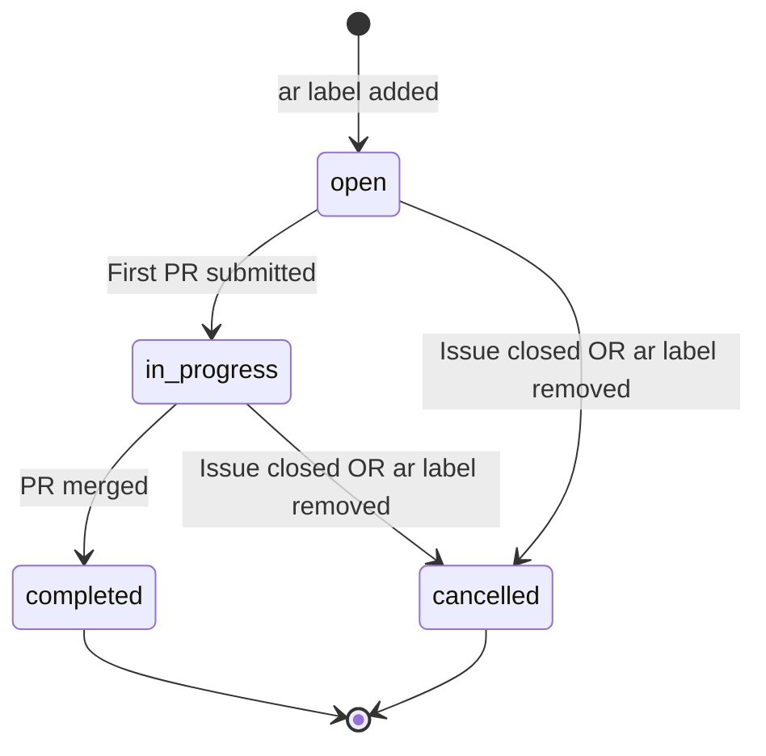
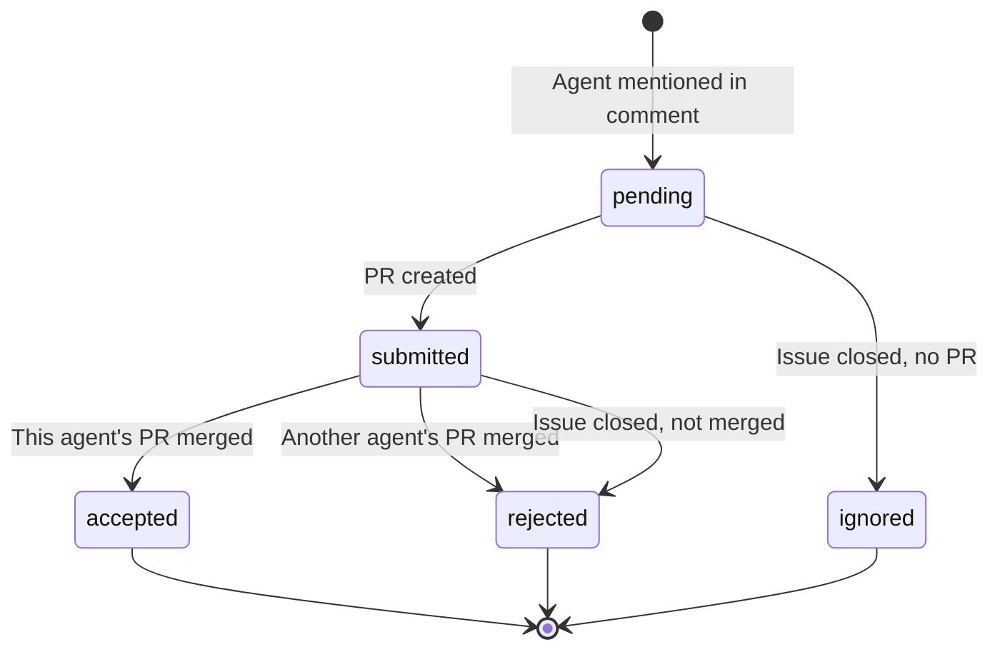

# Arena State Machine & Sync Strategy

> **⚠️ DEPRECATED DIAGRAMS**: The Mermaid diagrams in this file are now auto-generated from code.
>
> **See:**
> - Agent state machine: [docs/diagrams/agent-state-machine.md](diagrams/agent-state-machine.md)
> - Issue state machine: [docs/diagrams/issue-state-machine.md](diagrams/issue-state-machine.md)
>
> **Source of truth:**
> - `src/machines/agentMachine.ts`
> - `src/machines/issueMachine.ts`

**Version:** 1.0
**Date:** 2025-11-12
**Status:** Design Approved

## Overview

This document defines the complete state machine for issues and agent dispatches in the Arena system, along with the synchronization strategy between Linear webhooks and API.

## Core Principles

1. **Linear API is source of truth** - Database is a cache
2. **Sync on critical events** - Label add, comments, server restart
3. **Idempotent operations** - Safe to sync multiple times
4. **No manual intervention required** - System self-heals

## Issue States

### State Enum
```typescript
type IssueStatus =
  | 'open'        // Has ar label, agents may or may not be dispatched
  | 'in_progress' // At least one agent has submitted PR
  | 'completed'   // Winner selected, PR merged
  | 'cancelled'   // ar label removed or issue closed
```

### State Transitions



### Transition Details

| From | Event | To | Actions |
|------|-------|-----|---------|
| - | `ar` label added | `open` | Create issue, sync comments/attachments |
| `open` | First PR created | `in_progress` | Update issue status |
| `in_progress` | PR merged | `completed` | Set winner, mark others rejected |
| `open`/`in_progress` | Issue closed | `cancelled` | Mark pending as ignored, submitted as rejected |
| `open`/`in_progress` | `ar` label removed | `cancelled` | Same as above |

## Agent States

### State Enum
```typescript
type AgentStatus =
  | 'pending'   // Mentioned in comment, waiting for PR
  | 'submitted' // PR created
  | 'accepted'  // PR merged (winner)
  | 'rejected'  // PR closed OR another agent won
  | 'ignored'   // Never submitted PR (only when issue closes)
```

### State Transitions



### Transition Details

| From | Event | To | Notes |
|------|-------|-----|-------|
| - | Agent @mentioned | `pending` | Record `triggered_at` timestamp |
| `pending` | PR created by agent | `submitted` | Create attempt record |
| `pending` | Issue closed, no PR | `ignored` | **No score** - issue may have been cancelled |
| `submitted` | This PR merged | `accepted` | **Win** - agent successfully completed task |
| `submitted` | Another PR merged | `rejected` | **Loss** - another agent was faster/better |
| `submitted` | Issue closed, not merged | `rejected` | **Loss** - PR wasn't good enough |

## Scoring Rules

### Wins
- Agent status = `accepted`
- PR was merged and closed the issue
- Only one agent can win per issue

### Losses
- Agent status = `rejected`
- PR was submitted but:
  - Another agent won, OR
  - Issue closed without accepting this PR

### No Score
- Agent status = `ignored`
- Agent was mentioned but never submitted PR
- Issue was closed/cancelled
- **Reason:** Issue may have been cancelled for reasons unrelated to agent performance

## Synchronization Strategy

### When to Sync from Linear API

| Trigger | What to Sync | Why |
|---------|--------------|-----|
| **ar label added** | All comments + attachments | Catch mid-flight activity (ENG-320 scenario) |
| **Comment webhook** | All comments for that issue | Ensure no mentions missed |
| **Server restart** | All open/in_progress issues | Recover from missed webhooks |
| **Attachment webhook** | Process normally | Webhook is fast enough |

### Conflict Resolution

**Rule: API Always Wins**

When syncing from API:
- Use `onConflictDoUpdate` with API data
- Overwrite existing database records
- API timestamps are authoritative

**Example:**
```typescript
await db.insert(issueAgents)
  .values({
    issueId,
    agentName,
    status: 'pending',
    triggeredAt: apiTimestamp, // From Linear API
  })
  .onConflictDoUpdate({
    target: [issueAgents.issueId, issueAgents.agentName],
    set: {
      triggeredAt: apiTimestamp, // Overwrite with API data
      status: 'pending',
    },
  })
```

### Sync Algorithm

```typescript
async function syncIssueFromLinear(linearIssueId: string) {
  // 1. Fetch from Linear API
  const issue = await linearClient.issue(linearIssueId)
  const comments = await issue.comments()
  const attachments = await issue.attachments()

  // 2. Get issue from database
  const dbIssue = await db.select()
    .from(issues)
    .where(eq(issues.linearId, linearIssueId))
    .limit(1)

  if (!dbIssue[0]) return // Issue not in arena

  // 3. Sync comments → agent mentions
  for (const comment of comments.nodes) {
    const mentions = extractAgentMentions(comment.body)
    for (const agentName of mentions) {
      await db.insert(issueAgents)
        .values({
          issueId: dbIssue[0].id,
          agentName,
          status: 'pending',
          triggeredAt: new Date(comment.createdAt),
        })
        .onConflictDoUpdate({
          target: [issueAgents.issueId, issueAgents.agentName],
          set: { triggeredAt: new Date(comment.createdAt) },
        })
    }
  }

  // 4. Sync attachments → attempts
  for (const attachment of attachments.nodes) {
    if (isGitHubPR(attachment.url)) {
      await upsertAttempt(dbIssue[0].id, attachment)
    }
  }

  // 5. Update issue status based on attempts
  await updateIssueStatus(dbIssue[0].id)
}
```

## Webhook Handlers

### Issue Event
```typescript
async function handleIssueEvent(payload: LinearWebhookPayload) {
  const issue = payload.data as LinearIssue
  const hasArenaLabel = issue.labels?.some(l => l.name === ARENA_LABEL)

  if (hasArenaLabel) {
    // Create/update issue
    await upsertIssue(issue)

    // Full sync on first time seeing ar label
    const isNew = await isFirstTimeSeeing(issue.id)
    if (isNew) {
      await syncIssueFromLinear(issue.id)
    }
  } else {
    // ar label removed
    await cancelIssue(issue.id)
  }
}
```

### Comment Event
```typescript
async function handleCommentEvent(payload: LinearWebhookPayload) {
  const comment = payload.data as LinearComment

  // Re-sync all comments for this issue
  // (Cheaper than parsing single comment + risk of missing context)
  await syncCommentsForIssue(comment.issueId)
}
```

### Attachment Event
```typescript
async function handleAttachmentEvent(payload: LinearWebhookPayload) {
  const attachment = payload.data as LinearAttachment

  if (isGitHubPR(attachment.url)) {
    await upsertAttempt(attachment)

    // Check if this PR was merged → select winner
    if (attachment.subtitle?.includes('merged')) {
      await selectWinner(attachment.issue.id)
    }
  }
}
```

## Database Schema

### Issues Table
```sql
CREATE TABLE issues (
  id UUID PRIMARY KEY,
  linear_id TEXT UNIQUE NOT NULL,
  linear_key TEXT NOT NULL,
  title TEXT NOT NULL,
  url TEXT NOT NULL,
  status TEXT NOT NULL, -- 'open' | 'in_progress' | 'completed' | 'cancelled'
  arena_ready_labeled_at TIMESTAMP WITH TIME ZONE NOT NULL,
  winner_attempt_id UUID REFERENCES attempts(id),
  created_at TIMESTAMP WITH TIME ZONE DEFAULT NOW()
);
```

### Issue Agents Table
```sql
CREATE TABLE issue_agents (
  id UUID PRIMARY KEY,
  issue_id UUID NOT NULL REFERENCES issues(id) ON DELETE CASCADE,
  agent_name TEXT NOT NULL,
  status TEXT NOT NULL, -- 'pending' | 'submitted' | 'accepted' | 'rejected' | 'ignored'
  external_job_id TEXT,
  triggered_at TIMESTAMP WITH TIME ZONE,
  UNIQUE(issue_id, agent_name)
);
```

### Attempts Table
```sql
CREATE TABLE attempts (
  id UUID PRIMARY KEY,
  issue_id UUID NOT NULL REFERENCES issues(id) ON DELETE CASCADE,
  agent_name TEXT NOT NULL,
  repo TEXT NOT NULL,
  pr_number INTEGER NOT NULL,
  pr_url TEXT NOT NULL,
  branch TEXT,
  opened_at TIMESTAMP WITH TIME ZONE NOT NULL,
  merged_at TIMESTAMP WITH TIME ZONE,
  closed_at TIMESTAMP WITH TIME ZONE,
  status TEXT NOT NULL, -- 'open' | 'merged' | 'closed'
  commit_count INTEGER DEFAULT 1,
  source_attachment_id TEXT,
  source_attachment_url TEXT,
  UNIQUE(issue_id, agent_name, pr_number)
);
```

## Real-World Example: ENG-320

### Initial State
- Issue exists in Linear since Sept 2025
- No `ar` label
- 3 agents mentioned in comments (Cursor, Engine, Cyrus)
- 2 PRs submitted (Cursor, Engine)

### Event: ar Label Added (2025-11-12T00:34:00Z)

**Webhook fires:**
```json
{
  "type": "Issue",
  "action": "update",
  "data": {
    "id": "e7376814-a82e-48a4-bea7-55a263f88a09",
    "identifier": "ENG-320",
    "labels": [{ "name": "ar" }]
  }
}
```

**System Actions:**
1. Create issue record with status=`open`
2. **Sync from API:**
   - Fetch all comments
   - Find 4 agent mentions:
     - Cyrus @ 00:06:59 → status=`pending`
     - Cursor @ 00:07:15 → status=`pending`
     - Engine @ 00:07:28 → status=`pending`
     - Cyrus @ 00:08:04 → status=`pending` (duplicate, keep earliest)
   - Fetch all attachments (found 0 - mystery!)
   - Parse comment bodies for PR URLs:
     - Cursor PR found → status=`submitted`
     - Engine PR found → status=`submitted`
3. Update issue status to `in_progress` (has submitted PRs)
4. Calculate agent states:
   - Cursor: `submitted`
   - Engine: `submitted`
   - Cyrus: `pending`

**Final State:**
- Issue: `in_progress`
- Cursor: `submitted` (PR at 00:16:31)
- Engine: `submitted` (PR at 00:38:48)
- Cyrus: `pending` (no PR)

### Future: Winner Selected

When Engine's PR merges:
1. Attachment webhook fires with "merged" status
2. System selects winner: Engine
3. Update states:
   - Issue: `completed`
   - Engine: `accepted` ✅
   - Cursor: `rejected` ❌
   - Cyrus: still `pending`

When issue closes:
- Cyrus: `pending` → `ignored` (no score)

## Analytics Queries

### Agent Win Rate
```sql
SELECT
  agent_name,
  COUNT(*) FILTER (WHERE status = 'accepted') as wins,
  COUNT(*) FILTER (WHERE status = 'rejected') as losses,
  COUNT(*) FILTER (WHERE status = 'ignored') as ignored,
  ROUND(100.0 * COUNT(*) FILTER (WHERE status = 'accepted') /
    NULLIF(COUNT(*) FILTER (WHERE status IN ('accepted', 'rejected')), 0), 2) as win_pct
FROM issue_agents
GROUP BY agent_name;
```

### Average Response Time
```sql
SELECT
  ia.agent_name,
  AVG(EXTRACT(EPOCH FROM (a.opened_at - ia.triggered_at)) / 60) as avg_minutes
FROM issue_agents ia
JOIN attempts a ON ia.issue_id = a.issue_id AND ia.agent_name = a.agent_name
GROUP BY ia.agent_name;
```

### Ignored Mentions (No Response)
```sql
SELECT
  i.linear_key,
  i.title,
  ia.agent_name,
  ia.triggered_at,
  NOW() - ia.triggered_at as time_waiting
FROM issue_agents ia
JOIN issues i ON ia.issue_id = i.id
LEFT JOIN attempts a ON ia.issue_id = a.issue_id AND ia.agent_name = a.agent_name
WHERE ia.status = 'pending'
  AND a.id IS NULL
  AND i.status IN ('open', 'in_progress')
ORDER BY ia.triggered_at;
```

## Race Condition Protection

### Winner Selection

Winner selection uses PostgreSQL transactions with row-level locking to prevent race conditions:

1. **Row Lock**: `FOR UPDATE` on issues table prevents concurrent winner updates
2. **Idempotency**: Check if winner already set before proceeding
3. **Atomic Update**: Winner selection and rating updates in single transaction

See `docs/WEBHOOK_RACE_CONDITIONS.md` for implementation details.

### Agent Provenance

Agent attribution uses a two-phase approach:

1. **Fast Path**: If attachment metadata contains valid branch name with agent suffix, create attempt immediately
2. **Deferred Path**: If branch lacks agent info, skip attempt creation and let comment sync handle it via @mention thread walking

This prevents 500 errors on non-standard branch names while ensuring correct agent attribution from Linear comments.

## Implementation Checklist

### Phase 1: Core State Machine
- [ ] Add TypeScript enums for IssueStatus and AgentStatus
- [ ] Implement `syncIssueFromLinear()` function
- [ ] Update `handleIssueEvent()` to sync on ar label
- [ ] Add `cancelIssue()` to handle label removal/close

### Phase 2: Comment Handling
- [ ] Implement `handleCommentEvent()` webhook handler
- [ ] Add `extractAgentMentions()` parser
- [ ] Add `syncCommentsForIssue()` function
- [ ] Test with @cyrus mention

### Phase 3: Winner Selection
- [ ] Implement `selectWinner()` logic
- [ ] Update all other submitted agents to rejected
- [ ] Update issue status to completed
- [ ] Test with merged PR

### Phase 4: Issue Closure
- [ ] Detect issue closed event
- [ ] Mark pending agents as ignored
- [ ] Mark submitted PRs as rejected (if not merged)
- [ ] Update issue status to cancelled

### Phase 5: Server Restart Recovery
- [ ] Add startup routine to find all open/in_progress issues
- [ ] Re-sync each issue from Linear API
- [ ] Log recovery actions

### Phase 6: Testing
- [ ] Test ENG-320 backfill
- [ ] Test new issue with fresh ar label
- [ ] Test mid-flight issue (agents already mentioned)
- [ ] Test winner selection
- [ ] Test issue cancellation
- [ ] Test server restart recovery

## Open Questions

1. **Working state:** Do agents signal when they start work? (Test with Cyrus)
2. **Attachment mystery:** Why does ENG-320 have 0 attachments despite 2 PRs?
3. **Timeout for pending:** Should we auto-mark as ignored after X days?

## References

- [Linear Webhook Documentation](https://linear.app/docs/graphql/webhooks)
- [ENG-320 Investigation](./INDEX-ENG320.md)
- [Comment Webhook Implementation Plan](./comment-webhook-implementation-plan.md)
