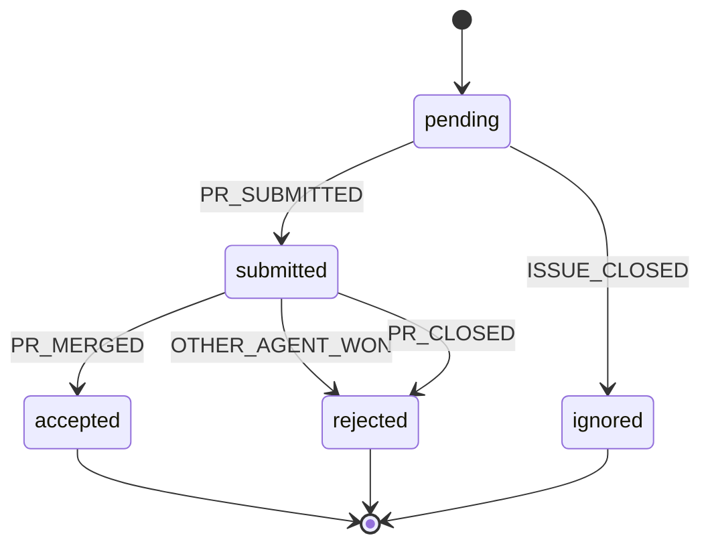

# Agent Lifecycle State Machine

**Generated from:** `src/machines/agentMachine.ts`
**Last Updated:** 2025-11-13T01:00:26.136Z

## States

- **pending**: Agent mentioned in Linear comment, waiting for PR
- **submitted**: PR created and linked to issue
- **accepted**: Agent's PR was merged (winner)
- **rejected**: Another agent won OR PR closed without merge
- **ignored**: Issue closed before agent submitted PR

## Events

- `PR_SUBMITTED`: Agent creates PR
- `PR_MERGED`: Agent's PR is merged
- `OTHER_AGENT_WON`: Different agent's PR was merged
- `PR_CLOSED`: Agent's PR was closed without merge
- `ISSUE_CLOSED`: Issue closed before PR submitted
