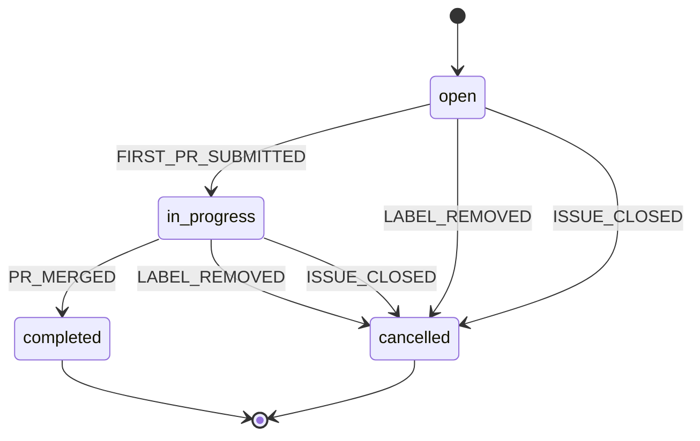

# Issue Lifecycle State Machine

**Generated from:** `src/machines/issueMachine.ts`
**Last Updated:** 2025-11-12T23:41:38.141Z

## States

- **open**: Issue has `arena:ready` label, agents may be dispatched
- **in_progress**: At least one agent has submitted a PR
- **completed**: Winner selected, PR merged
- **cancelled**: `arena:ready` label removed OR issue closed

## Events

- `FIRST_PR_SUBMITTED`: First agent submits PR (any agent)
- `PR_MERGED`: Winner's PR is merged
- `LABEL_REMOVED`: `arena:ready` label removed from issue
- `ISSUE_CLOSED`: Issue closed in Linear
