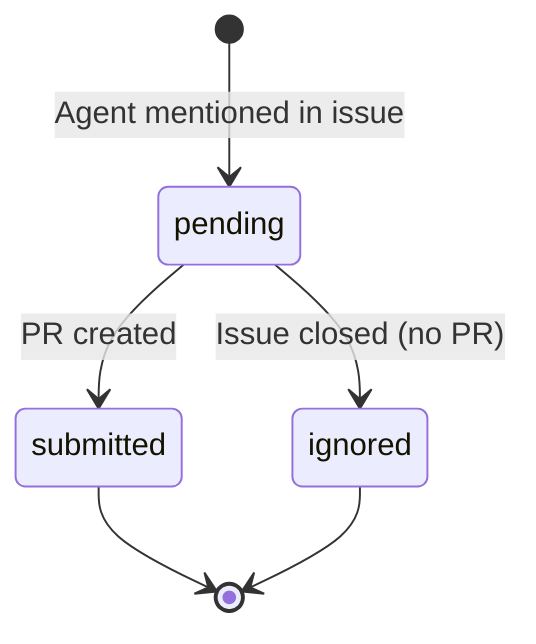
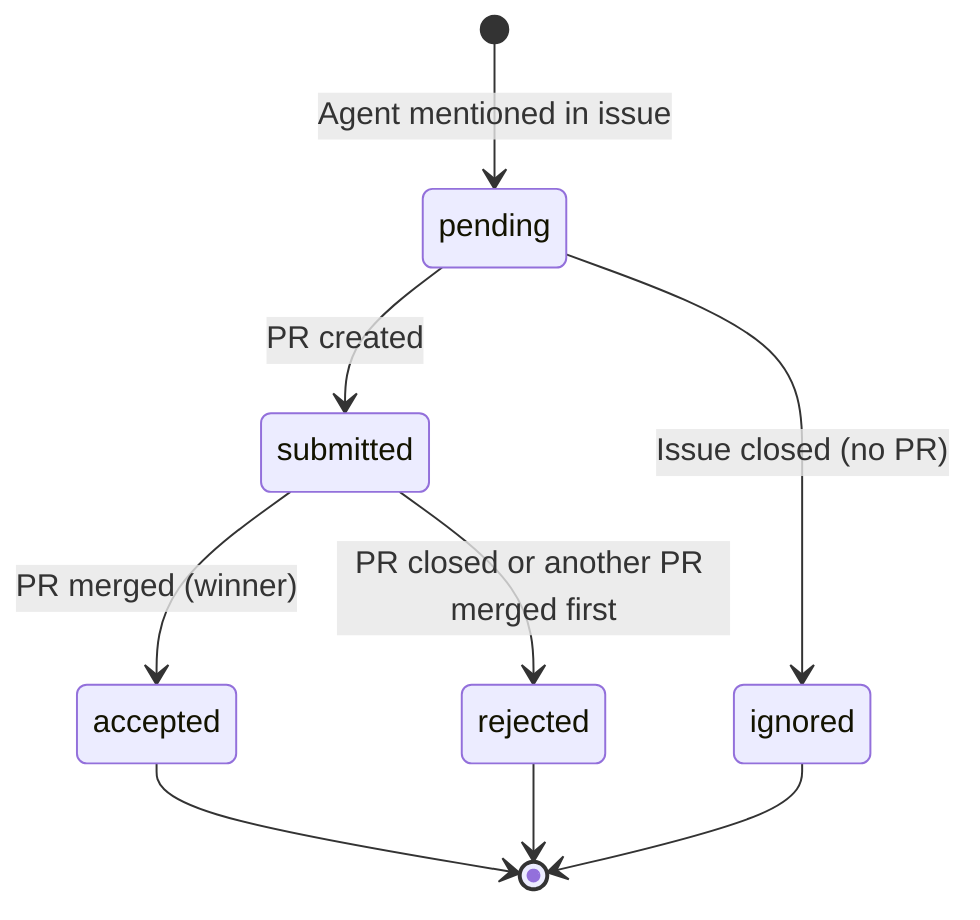

# Plan: Complete Agent Status Lifecycle Tracking

**Date**: 2025-11-12
**Status**: Proposed
**Priority**: High

## Problem Statement

The `issueAgents` table tracks agent mentions and PR submissions, but does not track the final outcome (merge/rejection) of those submissions. This creates a disconnect between:

1. **Type definitions** in `src/lib/queries.ts:210-221` that expect `accepted` and `rejected` statuses
2. **Actual code** that only ever sets `pending`, `submitted`, and `ignored` statuses
3. **User expectations** that the system tracks which agent "won" by having their PR merged first

Currently, merge outcomes are tracked in the `attempts` table (with `merged`/`closed` statuses), but this information never flows back to update the `issueAgents` status.

## Current State Diagram



## Desired State Diagram



## Current Code Locations

### Where Agent Status is Set

1. **`src/lib/linear-sync.ts:238`** - Creates agent with `pending` status when mentioned
2. **`src/lib/linear-sync.ts:304`** - Updates agent to `submitted` when PR attached
3. **`src/lib/agent-status.ts:63`** - Updates agent to `submitted` when PR created
4. **`src/lib/agent-status.ts:80`** - Updates pending agents to `ignored` when issue closed

### Where PR Outcomes are Tracked

1. **`src/app/api/github/webhook/route.ts:291`** - Sets attempt to `merged` on PR merge
2. **`src/app/api/github/webhook/route.ts:311`** - Sets attempt to `closed` on PR close

## Proposed Solution

### Option 1: Update Agent Status on PR Outcome (Recommended)

Add logic to `src/app/api/github/webhook/route.ts` in `handlePullRequestClosed()` to update the corresponding `issueAgents` record.

**Implementation Steps:**

1. After updating the `attempts` table, query for the associated agent:
   ```typescript
   const agentRecord = await db
     .select()
     .from(issueAgents)
     .where(
       and(
         eq(issueAgents.issueId, attempt.issueId),
         eq(issueAgents.agentName, attempt.agentName)
       )
     )
     .limit(1)
   ```

2. If PR was merged, check if this is the first merge for the issue:
   ```typescript
   if (merged && mergedAt) {
     const existingMerges = await db
       .select()
       .from(issueAgents)
       .where(
         and(
           eq(issueAgents.issueId, attempt.issueId),
           eq(issueAgents.status, 'accepted')
         )
       )

     if (existingMerges.length === 0) {
       // First merge - this agent wins
       await db.update(issueAgents)
         .set({ status: 'accepted' })
         .where(eq(issueAgents.id, agentRecord.id))

       // Mark all other submitted agents as rejected
       await db.update(issueAgents)
         .set({ status: 'rejected' })
         .where(
           and(
             eq(issueAgents.issueId, attempt.issueId),
             eq(issueAgents.status, 'submitted'),
             ne(issueAgents.id, agentRecord.id)
           )
         )
     } else {
       // Another PR already merged - this one is rejected
       await db.update(issueAgents)
         .set({ status: 'rejected' })
         .where(eq(issueAgents.id, agentRecord.id))
     }
   } else {
     // PR closed without merge - rejected
     await db.update(issueAgents)
       .set({ status: 'rejected' })
       .where(eq(issueAgents.id, agentRecord.id))
   }
   ```

3. Extract this logic into a new function in `src/lib/agent-status.ts`:
   ```typescript
   export async function updateAgentStatusOnPRClose(
     issueId: string,
     agentName: string,
     prMerged: boolean
   ): Promise<void>
   ```

### Option 2: Remove Unused Status Values

If we decide not to track PR outcomes at the agent level, remove the `accepted` and `rejected` status values from the type definitions in `queries.ts`.

**Pros:**
- Simpler, aligns with current implementation
- Reduces redundancy between `issueAgents` and `attempts` tables

**Cons:**
- Harder to query "which agent won this issue?"
- Need to join through `attempts` table to get this information
- Type definitions would no longer represent expected business logic

## Decision Required

**Recommended**: Option 1 - Complete the agent status lifecycle tracking.

**Reasoning:**
- The type definitions suggest this was the original intent
- Makes it easier to query agent win/loss records
- Aligns with the mental model that agents "compete" on issues
- The rating system already tracks outcomes via `attempts`, but having it in `issueAgents` provides a convenient denormalized view

## Testing Requirements

1. **Unit tests** for `updateAgentStatusOnPRClose()`
   - First PR merged → agent accepted, others rejected
   - Second PR merged → agent rejected
   - PR closed without merge → agent rejected

2. **Integration tests** for GitHub webhook
   - Multiple agents submit PRs, first merge wins
   - Verify rejected agents marked correctly

3. **Database migration** (if needed)
   - Add any necessary indexes on `issueAgents.status`
   - Backfill existing data if needed

## Migration Strategy

For existing records where `submitted` agents have corresponding `merged` attempts:

```sql
-- Find submitted agents whose attempts were merged
UPDATE issue_agents ia
SET status = 'accepted'
WHERE status = 'submitted'
  AND EXISTS (
    SELECT 1 FROM attempts a
    WHERE a.issue_id = ia.issue_id
      AND a.agent_name = ia.agent_name
      AND a.status = 'merged'
  );

-- Mark other submitted agents as rejected
UPDATE issue_agents
SET status = 'rejected'
WHERE status = 'submitted';
```

## Related Files

- `src/lib/agent-status.ts` - Agent status update logic
- `src/app/api/github/webhook/route.ts` - PR lifecycle webhook
- `src/lib/queries.ts` - Type definitions for agent status
- `src/db/schema.ts` - Database schema
- `src/types/database.ts` - TypeScript types

## Success Criteria

- [ ] Agent status correctly updated to `accepted` when PR merged first
- [ ] Other submitted agents marked `rejected` when an agent wins
- [ ] Agent status updated to `rejected` when PR closed without merge
- [ ] State diagram in docs matches actual code behavior
- [ ] All tests passing
- [ ] Type errors in `queries.ts` resolved
