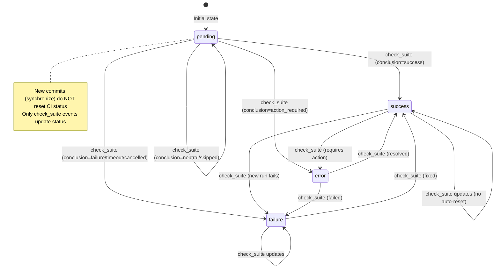
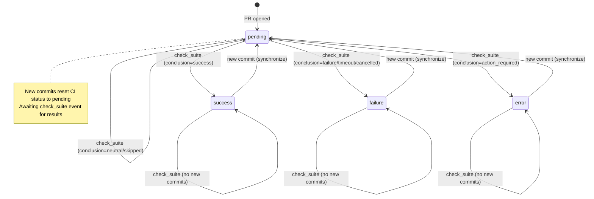

# Plan: Clarify CI Status Persistence Behavior

**Date**: 2025-11-12
**Status**: Documentation/Decision Required
**Priority**: Low

## Problem Statement

The CI status tracking behavior was incorrectly documented in the Mermaid state diagram. The diagram showed that new commits (via `synchronize` webhook events) reset CI status back to `pending`, but the actual code does NOT do this.

This raises questions about the intended behavior:
1. Should CI status persist across new commits?
2. Is the current behavior correct or is the code missing functionality?
3. What should users expect when they push new commits to a PR?

## Current Behavior

### What Actually Happens

When a new commit is pushed to a PR:
1. **GitHub webhook** sends `synchronize` event
2. **`handlePullRequestSynchronize()`** in `src/app/api/github/webhook/route.ts:114`
   - Updates `commitCount` by fetching from GitHub API
   - Updates `lastCommitSha`
   - **Does NOT touch `ciStatus`**
3. CI status remains at its previous value (`success`, `failure`, `error`, or `pending`)
4. Eventually, GitHub sends a new `check_suite` event when CI runs
5. **`handleCheckSuiteCompleted()`** updates `ciStatus` based on new results

### Current State Diagram (Corrected)



## Scenarios to Consider

### Scenario 1: Developer Pushes to Green PR

**Timeline:**
1. PR opened → CI runs → `ciStatus: 'success'`
2. Developer pushes new commit
3. `synchronize` event received
4. **Current behavior**: `ciStatus` stays `'success'`
5. New CI runs → `check_suite` event → `ciStatus` updated to `'success'` or `'failure'`

**Issue**: For a brief period, the database shows `success` but the PR is actually running CI. This is potentially misleading.

### Scenario 2: Developer Fixes Failing PR

**Timeline:**
1. PR opened → CI runs → `ciStatus: 'failure'`
2. Developer pushes fix
3. `synchronize` event received
4. **Current behavior**: `ciStatus` stays `'failure'`
5. New CI runs → `check_suite` event → `ciStatus` updated

**Issue**: The PR looks like it's still failing, even though CI is running the fix.

### Scenario 3: CI Never Completes

**Timeline:**
1. PR opened → CI runs → `ciStatus: 'success'`
2. Developer pushes new commit
3. `synchronize` event received
4. **Current behavior**: `ciStatus` stays `'success'`
5. CI gets stuck/cancelled, no `check_suite` event ever fires

**Issue**: PR incorrectly shows as passing when CI never completed.

## Options

### Option 1: Keep Current Behavior (Status Persists)

**Rationale**: Trust GitHub to send check_suite events reliably. Status represents "last known CI outcome."

**Pros**:
- Simple implementation
- No false "pending" states
- Matches GitHub PR UI (shows last status until new results)

**Cons**:
- Brief window where status is stale after new commit
- If check_suite event lost, status never updates

**Changes Needed**: None (just documentation)

### Option 2: Reset to Pending on Synchronize

**Rationale**: New commits invalidate previous CI results. Reset to pending until we know outcome.

**Pros**:
- More accurate representation of CI state
- No stale success/failure after new commits
- Defensive against missed check_suite events

**Cons**:
- More "pending" states shown to users
- Could be noisy if developer force-pushes frequently

**Changes Needed**:
```typescript
// In handlePullRequestSynchronize()
await db
  .update(attempts)
  .set({
    commitCount,
    lastCommitSha: headSha,
    ciStatus: 'pending', // ← Add this
    ciLastCheckedAt: new Date(), // ← Update timestamp
  })
  .where(eq(attempts.id, attempt.id))
```

### Option 3: Add "Running" State

**Rationale**: Distinguish between "we don't know yet" and "CI is actively running."

**Pros**:
- Most accurate representation
- Users understand CI is in progress

**Cons**:
- More complex state machine
- Need to handle timeout (running → pending if no check_suite)
- Requires schema change (add 'running' to ciStatus type)

**Changes Needed**:
```typescript
// In handlePullRequestSynchronize()
await db
  .update(attempts)
  .set({
    commitCount,
    lastCommitSha: headSha,
    ciStatus: 'running', // ← New status
    ciLastCheckedAt: new Date(),
  })
  .where(eq(attempts.id, attempt.id))

// In handleCheckSuiteCompleted()
// Add transition from 'running' to final state
```

### Option 4: Add Timestamp-Based Staleness

**Rationale**: Keep current behavior but expose staleness via timestamps.

**Pros**:
- No breaking changes
- Flexible - UI can decide how to display stale status
- Preserves historical data

**Cons**:
- Pushes complexity to UI layer
- Doesn't fix the fundamental issue

**Changes Needed**:
```typescript
// In handlePullRequestSynchronize()
await db
  .update(attempts)
  .set({
    commitCount,
    lastCommitSha: headSha,
    // ciStatus unchanged
    ciStatusSetAt: new Date(), // ← Add this field (new column)
    lastCommitPushedAt: new Date(), // ← Track when commit was pushed
  })
  .where(eq(attempts.id, attempt.id))

// UI can compare: if (lastCommitPushedAt > ciStatusSetAt) { show as "running" }
```

## GitHub's Actual Behavior

**Research needed**: How does GitHub's own UI handle this?

From observation:
- GitHub shows previous status until new check_suite completes
- Status has a "spinning" indicator when checks are running
- This suggests GitHub tracks both status AND "is running" separately

## Recommended Approach: Option 2 (Reset to Pending)

**Reasoning**:
1. **Correctness over optimization**: A new commit invalidates previous CI results
2. **Defensive programming**: Handles missed check_suite events
3. **User expectations**: Users expect to see "pending" after pushing new commits
4. **Simplicity**: No schema changes, just one line of code

**Trade-off**: More "pending" states, but this is accurate - the CI *is* pending.

## Implementation Plan

### 1. Update handlePullRequestSynchronize()

```typescript
async function handlePullRequestSynchronize(
  payload: GitHubWebhookPayload
): Promise<void> {
  // ... existing code ...

  // Update attempt
  await db
    .update(attempts)
    .set({
      commitCount,
      lastCommitSha: headSha,
      ciStatus: 'pending', // Reset CI status on new commit
      ciLastCheckedAt: new Date(), // Track when we reset
    })
    .where(eq(attempts.id, attempt.id))

  console.log(`[GitHub] Updated PR ${repo}#${prNumber}: ${commitCount} commits, CI reset to pending`)
}
```

### 2. Update State Diagram



### 3. Add Tests

```typescript
describe('handlePullRequestSynchronize', () => {
  it('resets CI status to pending on new commit', async () => {
    // Create attempt with success status
    const attempt = await createAttempt({ ciStatus: 'success' })

    // Trigger synchronize event
    await handlePullRequestSynchronize(mockSynchronizePayload)

    // Verify CI status reset
    const updated = await getAttempt(attempt.id)
    expect(updated.ciStatus).toBe('pending')
  })
})
```

## Alternative: Make it Configurable

If there's disagreement on correct behavior, make it configurable:

```typescript
// .env
CI_STATUS_RESET_ON_COMMIT=true # or false

// webhook code
const shouldResetCI = process.env.CI_STATUS_RESET_ON_COMMIT === 'true'

if (shouldResetCI) {
  await db.update(attempts).set({ ciStatus: 'pending', ... })
} else {
  await db.update(attempts).set({ commitCount, lastCommitSha, ... })
}
```

## Related Files

- `src/app/api/github/webhook/route.ts:114-154` - handlePullRequestSynchronize
- `src/app/api/github/webhook/route.ts:156-203` - mapCIStatus and state diagram
- `src/db/schema.ts:84` - ciStatus field definition
- `src/app/api/github/webhook/route.test.ts` - Tests for webhook handlers

## Success Criteria

- [ ] Decision made on intended behavior
- [ ] Code updated to match intended behavior (if needed)
- [ ] State diagram accurately reflects code
- [ ] Tests cover the behavior
- [ ] Documentation explains the rationale

## Decision Needed

**Question for stakeholders**: Should new commits reset CI status to `pending`?

**Recommendation**: Yes, implement Option 2 for accuracy and defensive programming.
