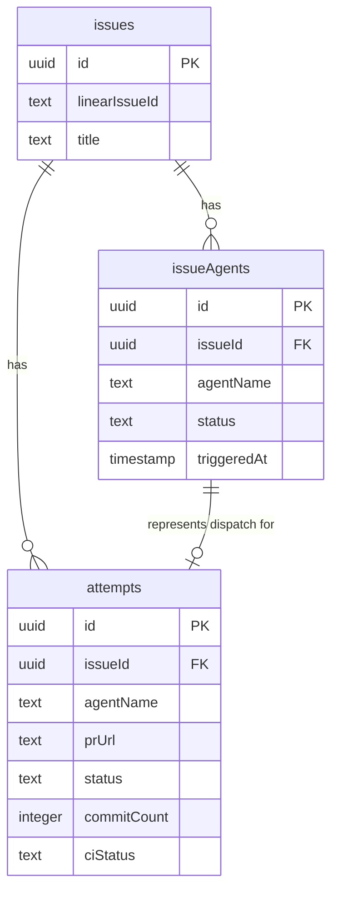

# Plan: Clarify issueAgents vs Attempts Table Relationship

**Date**: 2025-11-12
**Status**: Documentation/Architectural Review
**Priority**: Medium

## Problem Statement

There is confusion about the relationship and responsibilities between two tables:

1. **`issueAgents`** - Tracks which agents were mentioned/dispatched for an issue
2. **`attempts`** - Tracks actual PR submissions and their outcomes

The current implementation creates a disconnect where:
- Agent mentions are tracked in `issueAgents`
- PR outcomes are tracked in `attempts`
- There's no clear single source of truth for "which agent won?"

## Current Data Model

### issueAgents Table

```typescript
{
  id: uuid
  issueId: uuid -> issues.id
  agentName: text
  status: text // 'pending' | 'submitted' | 'ignored' (should be 'accepted' | 'rejected')
  externalJobId: text
  triggeredAt: timestamp
}
```

**Purpose**: Track agent dispatch and participation
**Created by**: Linear webhook when agent mentioned in issue
**Updated by**: Linear/GitHub webhooks when PR created/closed

### attempts Table

```typescript
{
  id: uuid
  issueId: uuid -> issues.id
  agentName: text
  repo: text
  prNumber: integer
  prUrl: text
  branch: text
  openedAt: timestamp
  mergedAt: timestamp
  closedAt: timestamp
  status: text // 'open' | 'merged' | 'closed'
  commitCount: integer
  lastCommitSha: text
  ciStatus: text // 'pending' | 'success' | 'failure' | 'error'
  ciLastCheckedAt: timestamp
  sourceAttachmentId: text
}
```

**Purpose**: Track PR lifecycle and metrics
**Created by**: Linear webhook when PR attachment added
**Updated by**: GitHub webhook on PR events (commits, CI, merge/close)

## Current Relationship



## Key Questions to Answer

### 1. Should issueAgents exist without attempts?

**Current Behavior**: YES
- Agent mentioned in Linear → `issueAgents` record created with `pending` status
- If agent never submits PR → remains `pending` or marked `ignored` when issue closes
- No `attempts` record created

**Use Case**: Track agent dispatch/interest even if no PR submitted

### 2. Should attempts exist without issueAgents?

**Current Behavior**: POSSIBLE (but shouldn't happen)
- If PR is attached to Linear issue directly without agent mention → `attempts` record created
- Agent name guessed from PR title/author
- No corresponding `issueAgents` record

**Use Case**: Manual PR submissions or external contributions?

### 3. Can one issueAgents have multiple attempts?

**Current Behavior**: NO (enforced by unique constraint)
- `issueAgents` has unique constraint on `(issueId, agentName)`
- `attempts` has no such constraint
- Same agent could theoretically submit multiple PRs

**Reality Check**: With the unique constraint, one agent can only have one "participation" record per issue, but could have multiple `attempts` if they close and reopen PRs.

## Proposed Clarity

### Option 1: issueAgents as "Dispatch Registry" (Current Model)

**Philosophy**: `issueAgents` tracks agent *intentions* or *assignments*, `attempts` tracks actual *work*.

**Rules**:
- One `issueAgents` record per (issue, agent) pair
- Zero or more `attempts` records per `issueAgents` record
- `issueAgents.status` reflects overall outcome (`accepted`/`rejected`)
- `attempts.status` reflects individual PR outcome (`merged`/`closed`)

**Queries Enabled**:
- "How many issues was agent X assigned to?" → Count `issueAgents`
- "How many PRs did agent X submit?" → Count `attempts`
- "What's agent X's win rate?" → `issueAgents` where `status='accepted'` / total

**Pros**:
- Clear separation of concerns
- Supports agent dispatch without PR requirement
- Easy to track "did agent participate?"

**Cons**:
- Redundant data between tables
- Need to keep in sync
- More complex queries for "who won this issue?"

### Option 2: Merge Tables (Alternative)

**Philosophy**: One table tracks both dispatch and attempts.

**Schema Change**: Add dispatch fields to `attempts`
```typescript
{
  // ... existing attempts fields
  dispatchedAt: timestamp
  dispatchStatus: text // 'dispatched' | 'pr_opened' | 'pr_merged' | 'pr_closed'
}
```

**Pros**:
- Single source of truth
- No sync issues
- Simpler data model

**Cons**:
- Conflates dispatch tracking with PR tracking
- Can't track "agent was mentioned but never submitted PR" cleanly
- Breaks existing queries

### Option 3: Make issueAgents a View (Read-Only Denormalization)

**Philosophy**: `attempts` is source of truth, `issueAgents` is a computed view.

```sql
CREATE VIEW issue_agents AS
SELECT
  issue_id,
  agent_name,
  CASE
    WHEN status = 'merged' THEN 'accepted'
    WHEN status = 'closed' THEN 'rejected'
    WHEN status = 'open' THEN 'submitted'
  END as status,
  MIN(opened_at) as triggered_at
FROM attempts
GROUP BY issue_id, agent_name;
```

**Pros**:
- No sync issues
- Always accurate
- Simpler code

**Cons**:
- Can't track dispatch without PR
- Lose external_job_id tracking
- May not align with original intent

## Recommended Approach: Option 1 (Current Model) with Clear Documentation

**Keep the current two-table model** but document the relationship clearly:

### issueAgents: Agent Participation Registry
- **Created when**: Agent mentioned in Linear issue (via dispatch webhook)
- **Lifecycle**: `pending` → `submitted` → `accepted`/`rejected`/`ignored`
- **Purpose**: Track which agents were involved, regardless of PR outcome
- **Single source of truth for**: Agent dispatch, overall win/loss per issue

### attempts: PR Attempt Tracking
- **Created when**: PR attached to Linear issue
- **Lifecycle**: `open` → `merged`/`closed`
- **Purpose**: Track PR metrics (commits, CI status, merge outcome)
- **Single source of truth for**: PR details, commit counts, CI results

### Relationship Rules

1. **One issueAgents per (issue, agent)** - Enforced by unique constraint
2. **One or more attempts per issueAgents** - Same agent can resubmit after closing PR
3. **issueAgents.status updated based on attempts outcomes** - See agent-status-tracking-completion.md
4. **Queries should join both tables** when needing full picture

## Code Changes Needed

### 1. Document the relationship in schema.ts

```typescript
/**
 * Issue Agents table - Tracks agent participation on issues
 *
 * Represents which agents were mentioned/dispatched for each issue.
 * This is the primary table for tracking agent involvement and outcomes.
 *
 * Relationship with attempts:
 * - One issueAgent can have multiple attempts (if agent resubmits PRs)
 * - issueAgent status reflects final outcome for the agent on this issue
 * - attempts table contains detailed PR metrics and lifecycle
 */
export const issueAgents = pgTable(...)

/**
 * Attempts table - Tracks individual PR submissions
 *
 * Each record represents one PR submission for an issue.
 * Contains detailed PR metrics, commit counts, and CI status.
 *
 * Relationship with issueAgents:
 * - Multiple attempts can exist for one issueAgent (PR resubmissions)
 * - Attempt status reflects outcome of that specific PR
 * - issueAgent status is derived from attempt outcomes
 */
export const attempts = pgTable(...)
```

### 2. Add helper queries for common patterns

In `src/lib/queries.ts`:

```typescript
/**
 * Get agent participation summary for an issue
 * Includes both issueAgents status and latest attempt details
 */
export async function getIssueParticipation(issueId: string) {
  return db
    .select({
      agentName: issueAgents.agentName,
      status: issueAgents.status,
      triggeredAt: issueAgents.triggeredAt,
      latestPrUrl: attempts.prUrl,
      latestPrStatus: attempts.status,
      commitCount: attempts.commitCount,
    })
    .from(issueAgents)
    .leftJoin(
      attempts,
      and(
        eq(attempts.issueId, issueAgents.issueId),
        eq(attempts.agentName, issueAgents.agentName)
      )
    )
    .where(eq(issueAgents.issueId, issueId))
}

/**
 * Get full PR history for an agent on an issue
 */
export async function getAgentAttempts(
  issueId: string,
  agentName: string
): Promise<Attempt[]> {
  return db
    .select()
    .from(attempts)
    .where(
      and(
        eq(attempts.issueId, issueId),
        eq(attempts.agentName, agentName)
      )
    )
    .orderBy(desc(attempts.openedAt))
}
```

## Documentation Needed

1. **Architecture doc**: `docs/architecture/data-model.md`
   - Entity relationship diagram
   - Table responsibilities
   - Common query patterns

2. **Comments in schema.ts**: Already outlined above

3. **State diagrams**: Already updated in code comments

## Success Criteria

- [ ] Clear documentation of table relationships
- [ ] Helper queries for common patterns
- [ ] Schema comments explaining purpose and relationships
- [ ] All developers understand when to use each table
- [ ] No confusion about "source of truth" for different data

## Related Plans

- See: `2025-11-12-agent-status-tracking-completion.md` for completing the status lifecycle
