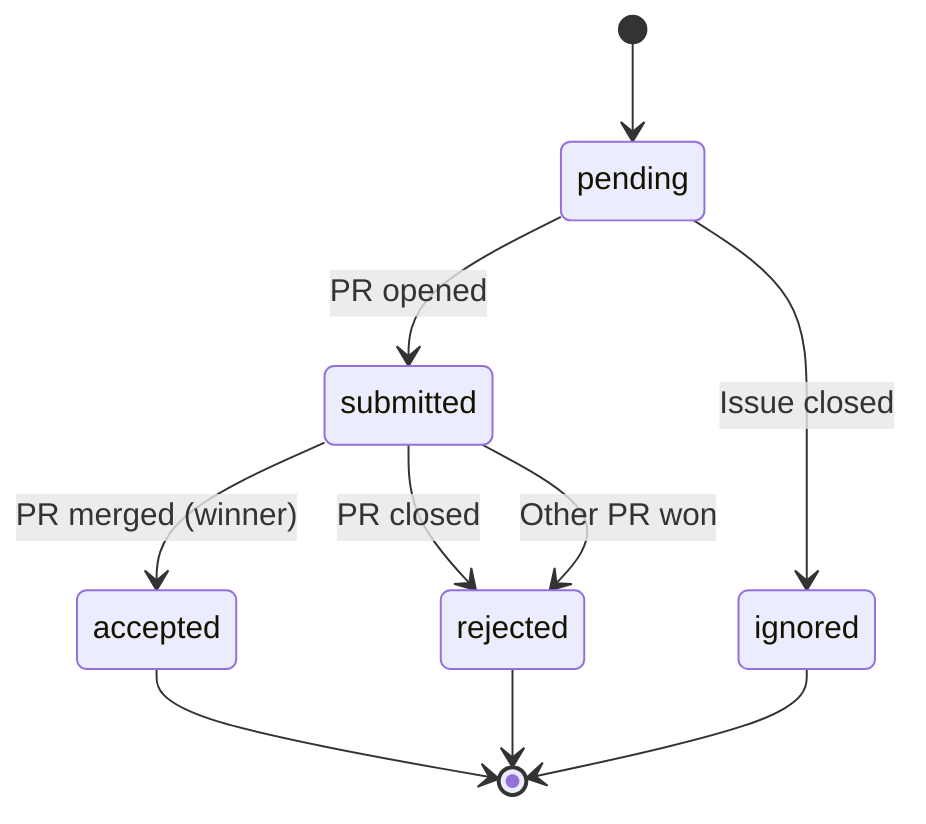

# Remove XState and Add Real State Documentation

**Created:** 2025-11-13
**Status:** Draft
**Context:** XState machines are not used in production - they're design artifacts disconnected from reality. Need to remove cleanly and replace with automated documentation that reflects actual code paths.

## Problem Statement

Current state:
- XState machines (`agentMachine.ts`, `issueMachine.ts`) exist but are never instantiated in production
- No `createActor()` calls outside tests
- Events are never sent - status updated imperatively via SQL
- `dispatch_failed` state exists in code but not in agent machine
- Issue machine stores Linear workflow names, not machine states
- Diagram generation uses custom parser, not `@xstate/graph`

This creates maintenance burden and misleading documentation.

## Goals

1. **Remove XState cleanly** - zero breaking changes
2. **Remove all XState-related code** - machines, tests, diagram generation, linting
3. **Replace with real documentation** - generate state flow docs from actual code paths

## Non-Goals

- Refactoring existing status update logic (SQL queries work fine)
- Adding event-driven architecture (imperative updates are acceptable)

## Implementation Plan

### Phase 1: Audit Dependencies

**Task 1.1: Search for all XState imports**
```bash
grep -r "from 'xstate'" src/
grep -r "from '@xstate/graph'" src/
grep -r "import.*xstate" src/
```

**Task 1.2: Search for all state machine usage**
```bash
grep -r "agentMachine" src/
grep -r "issueMachine" src/
grep -r "createActor" src/
```

**Task 1.3: Document all files that reference XState**
Create list of:
- Source files importing machines
- Test files using machines
- Config files (ESLint, package.json)
- Scripts using machines

**Expected files:**
- `src/machines/agentMachine.ts`
- `src/machines/issueMachine.ts`
- `src/machines/*.test.ts`
- `scripts/generate-state-diagrams.ts`
- `docs/diagrams/*.md` (generated)
- `package.json` (dependencies)
- `eslint.config.js` (plugin config)

**Verification:** Run searches, create checklist of affected files

---

### Phase 2: Remove XState Dependencies

**Task 2.1: Remove state machine source files**
```bash
rm src/machines/agentMachine.ts
rm src/machines/issueMachine.ts
```

**Task 2.2: Remove state machine test files**
```bash
rm src/machines/*.test.ts
```

**Task 2.3: Remove diagram generation script**
```bash
rm scripts/generate-state-diagrams.ts
```

**Task 2.4: Remove generated diagram files**
```bash
rm docs/diagrams/agent-state-machine.md
rm docs/diagrams/issue-state-machine.md
```

**Task 2.5: Remove npm dependencies**
Edit `package.json`:
- Remove `"xstate": "^5.24.0"` from dependencies
- Remove `"@xstate/graph": "^3.0.4"` from dependencies
- Remove `"eslint-plugin-xstate": "^3.2.1"` from devDependencies
- Remove `"generate-diagrams": "tsx scripts/generate-state-diagrams.ts"` script
- Update `"build"` script to remove `npm run generate-diagrams &&`

**Task 2.6: Run npm install**
```bash
npm install
```

**Verification:** `node_modules/xstate` should not exist after install

---

### Phase 3: Remove ESLint XState Plugin

**Task 3.1: Remove plugin from ESLint config**
Edit `eslint.config.js`:
- Remove `eslint-plugin-xstate` import
- Remove plugin from config array
- Remove any XState-specific rules

**Task 3.2: Test ESLint still works**
```bash
npm run lint
```

**Verification:** Lint passes with zero errors, no XState references

---

### Phase 4: Verify No Breaking Changes

**Task 4.1: Run type checking**
```bash
npm run type-check
```

**Expected:** Zero TypeScript errors

**Task 4.2: Run all tests**
```bash
npm run test
```

**Expected:** All tests pass, 90%+ coverage maintained

**Task 4.3: Run full validation**
```bash
npm run validate
```

**Expected:** All checks pass

**Task 4.4: Start dev server**
```bash
npm run dev
```

**Expected:** Server starts on port 3109 without errors

**Task 4.5: Verify UI loads**
Navigate to `http://localhost:3109`

**Expected:** Homepage renders, no console errors

**Task 4.6: Test database queries**
Check that agent status queries still work (they use SQL CASE statements, not machines)

**Expected:** `/api/issues` endpoint returns data with computed statuses

---

### Phase 5: Design Real State Documentation System

**Task 5.1: Analyze actual state transitions in code**
Identify where status changes occur:
- `src/lib/agent-status.ts` - Agent status updates
- `src/lib/queries.ts:673-694` - Dynamic status computation via SQL
- `src/app/api/github/webhook/route.ts` - PR status handling
- `src/app/api/linear/webhook/route.ts` - Linear issue updates

**Task 5.2: Extract state transition patterns**
Document actual state flows:

**Agent States (from SQL in queries.ts):**
```
pending -> submitted (when PR created)
submitted -> accepted (when PR merged and is winner)
submitted -> rejected (when PR closed OR another PR merged)
pending -> ignored (when issue closed before PR)
```

**Issue States (from Linear integration):**
```
[Linear Workflow Status] -> stored directly in issues.status
Example: "Todo", "In Progress", "Done", "Cancelled"
```

**Task 5.3: Choose documentation format**
Options:
1. **Markdown tables** - Simple, version controlled
2. **Mermaid diagrams** - Visual, generated from markdown
3. **JSDoc annotations** - Inline with code
4. **TypeDoc with custom plugin** - Generated API docs

**Recommendation:** Combine approaches:
- Markdown with Mermaid for high-level flows
- JSDoc annotations in actual status update functions
- TypeDoc generation includes state transition docs

**Task 5.4: Create state flow documentation template**
Create `docs/state-flows.md`:

```markdown
# State Flows

## Agent Lifecycle

**Source:** `src/lib/queries.ts:673-694` (computed dynamically)



**Status Computation Logic:**
- `accepted`: Winner attempt OR any merged PR for agent
- `submitted`: PR is open
- `rejected`: PR closed without merge
- `pending`: Default state

**Code References:**
- Status query: `src/lib/queries.ts:673-694`
- Updates: `src/lib/agent-status.ts`

## Issue Lifecycle

**Source:** `src/db/schema.ts` + Linear webhook integration

Issues store Linear workflow status directly in `issues.status`.

**Common flows:**
- `Todo` -> `In Progress` -> `Done`
- `Todo` -> `Cancelled`
- `In Progress` -> `Cancelled`

**Arena-specific tracking:**
- `arenaReadyLabeledAt`: When `arena:ready` label added
- `winnerAttemptId`: Links to winning attempt when complete

**Code References:**
- Schema: `src/db/schema.ts:20-59`
- Linear webhook: `src/app/api/linear/webhook/route.ts`
```

**Task 5.5: Add JSDoc annotations to status functions**
Example for `src/lib/agent-status.ts`:

```typescript
/**
 * Updates agent status based on PR lifecycle.
 *
 * @remarks
 * State transitions:
 * - `pending` -> `submitted`: When first PR created
 * - `submitted` -> `accepted`: When PR merged as winner
 * - `submitted` -> `rejected`: When PR closed or another agent wins
 *
 * @param agentName - Agent identifier
 * @param status - New status value
 */
export async function updateAgentStatus(agentName: string, status: string) {
  // ... implementation
}
```

**Task 5.6: Generate TypeDoc with state annotations**
Update `typedoc.json` to include state flow documentation.

---

### Phase 6: Create Automated Documentation Script

**Task 6.1: Create script to extract state transitions**
Create `scripts/document-state-flows.ts`:

```typescript
/**
 * Analyzes code to document actual state transitions.
 *
 * Extracts:
 * - SQL CASE statements from queries
 * - Status update function calls
 * - Webhook handler state changes
 *
 * Generates markdown documentation with Mermaid diagrams.
 */
```

**Task 6.2: Add script to package.json**
```json
"docs:states": "tsx scripts/document-state-flows.ts"
```

**Task 6.3: Integrate into build process**
Update `package.json` build script:
```json
"build": "npm run docs:states && npm run validate && next build"
```

---

### Phase 7: Final Verification

**Task 7.1: Run complete validation**
```bash
npm run validate
```

**Task 7.2: Build production bundle**
```bash
npm run build
```

**Task 7.3: Review generated state documentation**
```bash
cat docs/state-flows.md
```

**Task 7.4: Verify TypeDoc includes state annotations**
```bash
npm run docs
open docs/api/index.html
```

---

## Success Criteria

- [ ] No XState dependencies in `package.json`
- [ ] No XState imports in any source files
- [ ] All tests pass with 90%+ coverage
- [ ] Type checking passes at 99.9%
- [ ] ESLint passes with zero warnings
- [ ] Dev server starts without errors
- [ ] `docs/state-flows.md` accurately reflects actual code paths
- [ ] State transition logic documented with JSDoc
- [ ] Build succeeds and generates updated docs

## Risks and Mitigations

**Risk:** Removing machines breaks tests that rely on them
**Mitigation:** Phase 4 verification catches this early

**Risk:** Other developers have uncommitted work importing machines
**Mitigation:** Coordinate with team, check for concurrent branches

**Risk:** New documentation approach requires too much manual maintenance
**Mitigation:** Automate extraction from code with script in Phase 6

**Risk:** Missing state transitions in new documentation
**Mitigation:** Cross-reference SQL queries, webhook handlers, status update functions

## Alternative Approaches Considered

**Keep XState but actually use it:**
- Rejected: Would require major refactoring of SQL-based status logic
- Current imperative approach works fine for this use case

**Use state machine library that generates from code:**
- Rejected: No mature TypeScript solutions that extract from SQL/imperative code
- Custom documentation script is simpler

**Manual documentation only:**
- Rejected: Will drift from reality like XState did
- Automated extraction ensures docs stay current

## Open Questions

1. Should we keep generated Mermaid diagrams in git or regenerate on build?
   - **Recommendation:** Keep in git for easy viewing, regenerate on build

2. Should state transition docs be in separate file or inline with code?
   - **Recommendation:** Both - high-level overview in `docs/state-flows.md`, details in JSDoc

3. Do we need visual diagrams or is markdown sufficient?
   - **Recommendation:** Keep Mermaid - visual flows are valuable for onboarding

## Timeline Estimate

- Phase 1 (Audit): 15 minutes
- Phase 2 (Remove deps): 10 minutes
- Phase 3 (ESLint): 5 minutes
- Phase 4 (Verify): 15 minutes
- Phase 5 (Design docs): 30 minutes
- Phase 6 (Automation): 45 minutes
- Phase 7 (Final verification): 15 minutes

**Total:** ~2.5 hours for complete implementation and verification

## Notes

- Coordinate with agent working on agent discovery changes to avoid conflicts
- This is a pure deletion + documentation task - no behavior changes
- Keep git history clean with logical commits per phase
